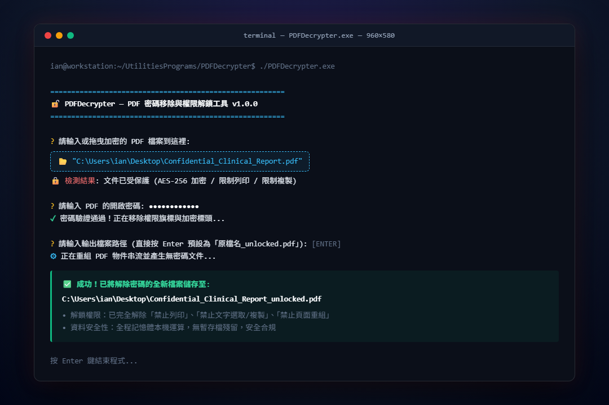
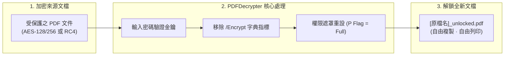

<div align="center">

# 🔓 PDFDecrypter

**Lightweight, Zero-Telemetry PDF Password Decryption & Restriction Removal Engine**

[](https://github.com/ian030590/PDFDecrypter/stargazers)
[](https://opensource.org/licenses/MIT)
[](https://www.python.org/)
[](https://github.com/ian030590/PDFDecrypter)
[](https://github.com/ian030590/PDFDecrypter/pulls)

<br />

<p align="center">
  
</p>

<p align="center">
  <b>純本機、零隱私疑慮的 PDF 密碼移除與權限解鎖工具，支援終端機路徑拖曳與一次性解密輸出。</b>
</p>

</div>

---

## 📖 目錄 (Table of Contents)

- [產品簡介 (Overview)](#-產品簡介-overview)
- [核心優勢 (Key Highlights)](#-核心優勢-key-highlights)
- [解密與權限移除原理 (How It Works)](#-解密與權限移除原理-how-it-works)
- [快速上手 (Quick Start)](#-快速上手-quick-start)
  - [模式 A：免安裝 Portable EXE (推薦)](#模式-a免安裝-portable-exe-推薦)
  - [模式 B：Python 原始碼執行](#模式-bpython-原始碼執行)
- [專案結構 (Directory Structure)](#-專案結構-directory-structure)
- [合規與資安保障 (Compliance & Security)](#-合規與資安保障-compliance--security)
- [授權協議 (License)](#-授權協議-license)

---

## 🌟 產品簡介 (Overview)

許多由金融機構、醫療單位或官方機關核發的電子文件（如個人健檢報告、銀行對帳單、薪資單或合約掃描檔）均設有個人身分證字號或生日加密，且常限制「禁止複製文字」、「禁止高畫質列印」或「禁止頁面合併抽換」。每次開啟均需重複鍵入密碼，亦無法導入文獻管理軟體（如 Zotero、EndNote）進行全文檢索。

市面上的免費解密網站存在嚴重的**機密外洩與隱私風險**。**PDFDecrypter** 提供 100% 純本機運行的命令列解鎖方案，在驗證使用者持有之合法密碼後，自動剔除 PDF 結構中的加密安全字典（Encrypt Dictionary）與各項權限遮罩，輸出標準完全開放之 PDF 文件。

---

## ✨ 核心優勢 (Key Highlights)

- 🔒 **極致隱私保護 (Zero-Data Leakage)**：所有解密計算均於本機記憶體完成，完全不連網、無暫存檔殘留，守護臨床病歷與敏感財務資料。
- 🖱️ **直覺檔案拖曳 (Drag & Drop)**：在終端機提示時可直接將 PDF 檔案由檔案總管拖曳入視窗，程式自動去除路徑引號與格式轉義。
- 🔓 **全權限完整解鎖 (Permission Strip)**：一鍵清除包括列印限制（Printing）、內容複製（Copying/Extraction）、註解修改（Commenting）及頁面重組（Assembly）等各項保護限制。
- 📦 **免安裝 Portable 單一執行檔**：已預先打包為單一獨立 EXE，下載即用，無須設定 Python 開發環境。
- ⚡ **無損結構重建**：重組底層 PDF 交叉引用表（XRef），完美保留原文件所有向量圖形、高解析影像、內嵌字型與超連結。

---

## 🏗️ 解密與權限移除原理 (How It Works)



---

## 🚀 快速上手 (Quick Start)

### 模式 A：免安裝 Portable EXE (推薦)

1. 下載 `dist/` 資料夾內的 `PDFDecrypter.exe`。
2. 雙擊執行 `PDFDecrypter.exe`。
3. 直接將加密的 PDF 檔案**拖曳**進終端機黑視窗中，按下 Enter。
4. 輸入該文件的開啟密碼。
5. 按下 Enter 確認輸出路徑，程式即自動於同目錄產出解鎖完成的 `[檔名]_unlocked.pdf`！

### 模式 B：Python 原始碼執行

適用於 Linux、macOS 或開發者整合：

```bash
# 1. 複製專案
git clone https://github.com/ian030590/PDFDecrypter.git
cd PDFDecrypter

# 2. 安裝必要套件
pip install pypdf

# 3. 啟動解密工具
python PDFDecrypter.py
```

---

## 📁 專案結構 (Directory Structure)

```text
PDFDecrypter/
├── assets/
│   └── screenshot.png         # CLI 終端互動執行展示圖
├── dist/
│   └── PDFDecrypter.exe       # 預先編譯免安裝單一執行檔
├── build/                     # PyInstaller 建置暫存檔
├── PDFDecrypter.py            # 解密核心演算與終端互動邏輯
├── PDFDecrypter.spec          # PyInstaller 打包設定檔
└── README.md                  # 專案技術與使用說明文件
```

---

## 🛡️ 合規與資安保障 (Compliance & Security)

> [!IMPORTANT]
> **法律與合規提醒**：本工具設計目的為協助使用者合法管理自身擁有或已獲合法授權存取之文件（如解除個人薪資單、電子帳單或病歷報告之反覆輸入密碼繁瑣步驟）。請勿用於未經授權之檔案破解或侵犯他人智慧財產權。

---

## 📄 授權協議 (License)

本專案採用 [MIT License](LICENSE) 授權開源。

<div align="center">
  <sub>Crafted with ❤️ by <a href="https://github.com/ian030590">Ian</a>.</sub>
</div>
